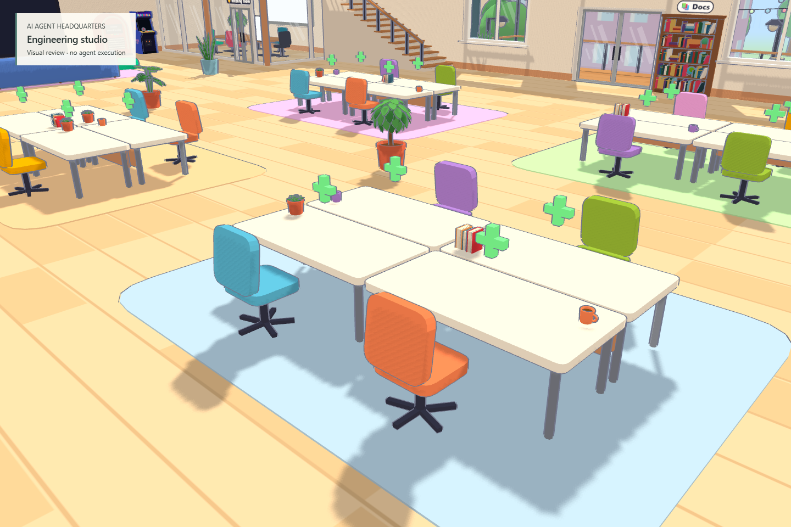
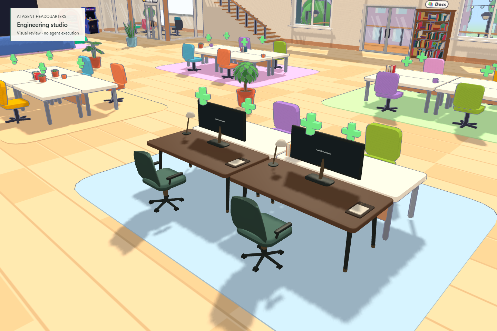

# Phase 0 and first Phase 1 increment

## Implemented

Audited the fork at `852e2ab28c4f3f31bffdf4b20353bd119c9d3270` and built an isolated two-workstation increment. Original Blender furniture adds walnut surfaces, graphite frames, bronze hardware, upholstered chairs, task lamps and real terminal monitors. The room, characters, renderer and backend retain their existing architecture. This is not the completed premium-room milestone.

## Architecture

`features/headquarters/world.ts` contributes a fixture through the existing office registry, retaining desk IDs, colliders and operational anchors. `materials.ts` owns the shared palette. `index.ts` paints existing authenticated `store.screens` frames and worker identity/status; it does not generate work or infer progress from animation. Reconnect hides cached frames until the next authoritative welcome. Failed model loading retains the original furniture. The global renderer, protocol, providers and lockfile were not replaced.

The audit identifies WebGPU/shader parity, skeletal-worker replacement, persistent identity migration and unsupported Grok Bot APIs as separate compatibility work. See [architecture audit](ARCHITECTURE_AUDIT.md), [graphics decisions](GRAPHICS_PIPELINE.md), [asset manifest](ASSET_MANIFEST.md) and [state model](AGENT_STATE_MODEL.md).

## Visual evidence

Before:

After:

Matching [overview before](evidence/before-overview.png) and [overview after](evidence/after-overview.png) show the limited scope. Four views were captured and inspected; lounge/meeting areas retain their original appearance. Live terminal, monitor, meeting-controls, missing-model and 2D screenshots remain in local `artifacts/modernization/after`. The seasonal avatar and decorations are still the existing office art and can obscure the display at a close first-person approach; character/readability polish remains future work.

## Verification and performance

Typecheck and production build pass. Thirty focused tests pass, including dimensions/UVs, stale-output clearing, feature registration, `/lite` isolation and source-size limits. Real local login → shell → terminal echo → removal, meeting-controls open/close and 2D connection pass. Deliberate GLB download failure leaves usable original desks.

The full suite is **not green on this Windows host**: bounded comparison found 34 reported failures on clean base and 31 after the visual change, with `workers.test.ts` timing out in both. No new failing file was observed. See [exact methodology and results](PERFORMANCE_BENCHMARKS.md).

Static workstation view: 75.00 → 75.00 FPS; frame p95 13.5 → 13.5 ms; draw calls 2,587 → 2,539; rendered triangles 427,781 → 465,313. These include shadow/outline passes. This measures a static hardware sample, not GPU time, memory bytes or multi-agent runtime performance.

## Compatibility and remaining work

Verified existing terminal and meeting UI paths remain usable. Paid provider execution, genuine meeting completion, multiplayer voice/screenshare, browser/network restart recovery and non-Windows testing remain unverified. No release, deployment, credential handling or backend migration is included.

Next: extend the preliminary visual direction into coherent floor/wall/window materials and lighting around this pair of desks, then validate two refined characters against existing seat/hand/status contracts. Add measured quality presets and complete the small room's visual and real-provider acceptance before expanding the office. See [roadmap](ROADMAP.md).
