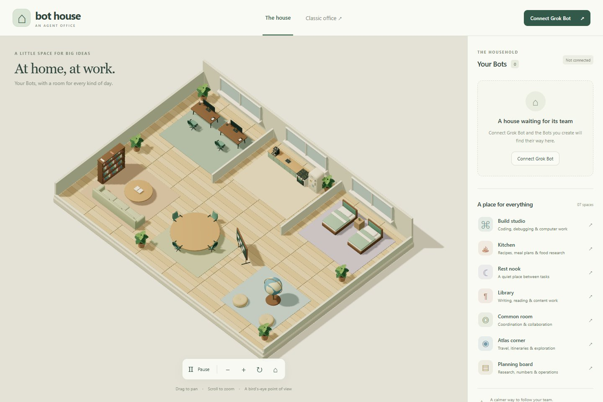
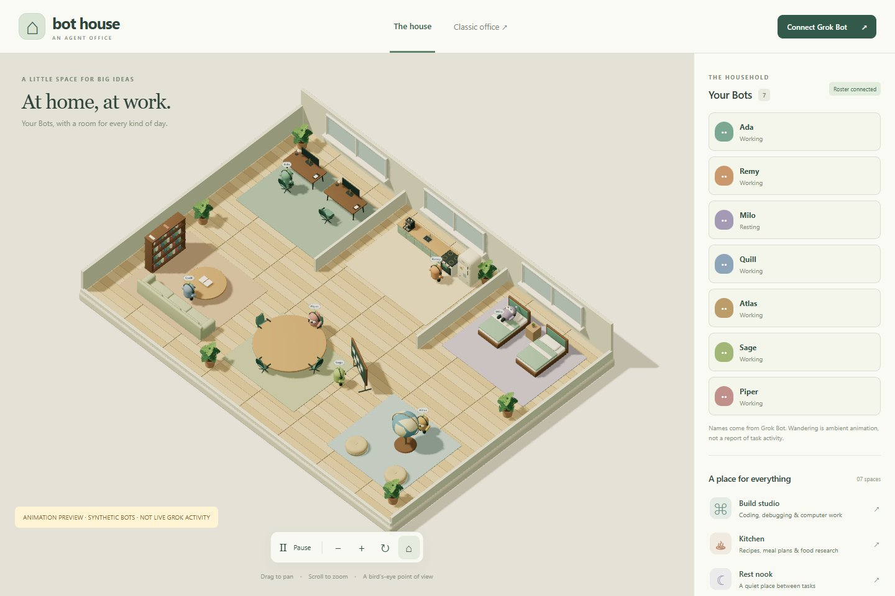

# Bird's-eye house delivery

The default page is now a Sims-style overhead house. It has seven recognizable activity places, pan/zoom/quarter-turn controls, selectable named residents, ambient wandering and task poses. Four common-room chairs face inward toward the table. The original first-person office remains at `/office.html`, and `/lite` remains independent. Work started in an isolated `codex/simulation-view` worktree from freshly fetched fork main `9da3ac0` after PR #1 was merged.

## Actual disconnected view

No sample Bots are inserted into normal runtime. The user chose to leave Grok Bot disconnected. No provider sign-in, Bot creation, remote task or paid agent execution was attempted.

## Animation verification, explicitly synthetic

This is browser-test data, not a live Grok Bot session. Coding, cooking, sleeping, reading/writing, globe research, analysis and coordination poses were exercised using a temporary local snapshot. The test marks the screenshot as synthetic and removes that snapshot afterward. Live Grok task-to-station mapping remains pending a trustworthy lifecycle feed.

## Integration boundary

The authenticated `/api/simulation` route reads an account-scoped, bounded, versioned projection. Stable IDs drive additions, renames and removals. Expired or failed observations clear task activity; incomplete connectivity never confirms deletion. Unknown and idle are distinct. Finite station reservations avoid stacking several Bots onto the same chair or bed. Overflow residents remain in the aisle.

The optional source-checkout bridge is read-only and disabled by default. It verifies a pinned unofficial SDK, requests a fresh browser login, keeps tokens in memory, permits only three identity/roster/auth endpoints, rejects redirects/oversized responses and writes only a sanitized local roster. There are no transcripts, message sends, remote tools or desktop credential extraction. The roster does not expose normalized current-task or working/idle state, so the bridge emits `unknown`. See [the full setup and limits](../grok-bot.md).

The existing execution store, worker manager, provider hooks, terminal flow and WebSocket protocol were preserved. The new page has its own renderer/camera rather than a player-controlled view. Safe login destinations return Classic and Lite users to their requested surface. New server behavior enters through the existing HTTP route registry.

## Verification evidence

| Boundary | Result |
| --- | --- |
| TypeScript and production build | Pass |
| Focused regression/structure/model/bridge checks | 36 pass; affected movement tests rerun after routing adjustment |
| Anonymous request to `/api/simulation` | 401 |
| Shared-password login → real API → scoped snapshot → browser | Pass on Vite and built production server |
| Real file-driven add, exact rename, selection and removal | Pass with synthetic fixture, cleaned afterward |
| Error/stale observations | Household retained; task activity becomes unavailable |
| Dialog ✕ and Esc | Close successfully and return focus to free-pointer canvas |
| House controls and 390px mobile layout | Pass; no horizontal overflow |
| Classic office | Loads, receives authenticated welcome, and renders |
| Browser page errors | None in completed runs |
| Live Grok Bot account and task lifecycle | Not tested; deliberately disconnected |

Evidence: [Vite flow](evidence/simulation-verification-vite.json), [production flow](evidence/simulation-verification-production.json), [bounded full-suite results](evidence/simulation-tests.json), [render benchmark](evidence/simulation-benchmark.json).

`npm test` was invoked but does not finish cleanly on this Windows host. The bounded diagnostic runner (normal local access, same Node imports, 60 seconds per file) reports **86 files: 79 passing, six failing, one worker-test timeout; 563 passing tests and 31 failures**. The failure families match the earlier workstation baseline: clone (6), docs (1), DeepSeek harness (17), install (1), maps (3), repositories (3), plus the worker timeout. Sandbox-only Git/loopback failures were separated by rerunning with normal local access. This is not a claim of a green full suite. No unrelated test was suppressed or modified.

At 1440×960, DPR 1, empty production house, headless Edge on an NVIDIA RTX 3060 Laptop: **74.06 FPS**, p95 frame interval **13.5 ms**, local login-to-ready **432 ms**. This is one 239-interval sample near the display cap, not a hardware guarantee or comparative speedup. No crowded-house performance claim is made. The floor uses three instanced batches instead of 256 individual plank draw calls.

## Remaining work

- Evaluate a supported activity feed before mapping real Grok work to a landmark; the identity-only bridge cannot do this.
- Richer activity-specific gestures, obstacle-aware crowd separation and larger-household layout. Current routes use authored room approaches and a clear central aisle.
- Broader quality tiers, accessibility review and low-end GPU/device measurements.
- Live provider/meeting validation and the pre-existing Windows failures remain outside this visual increment.

Original assets and provenance are documented in the [asset manifest](ASSET_MANIFEST.md). No external commercial art, new runtime dependency, deployment configuration or automated merge was introduced.
